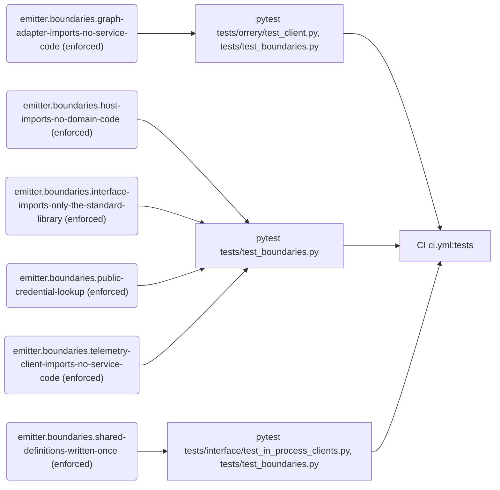
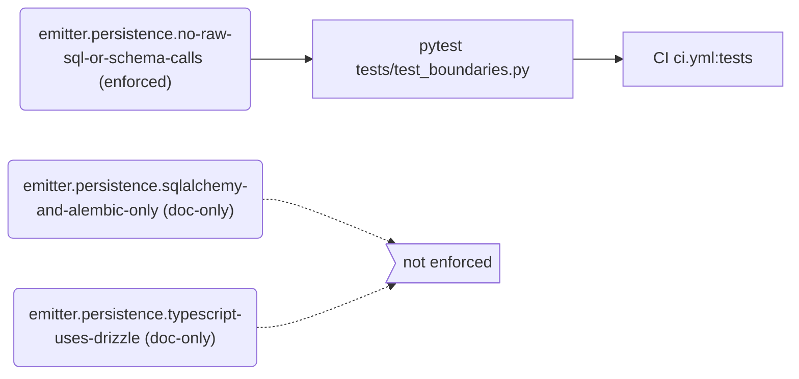
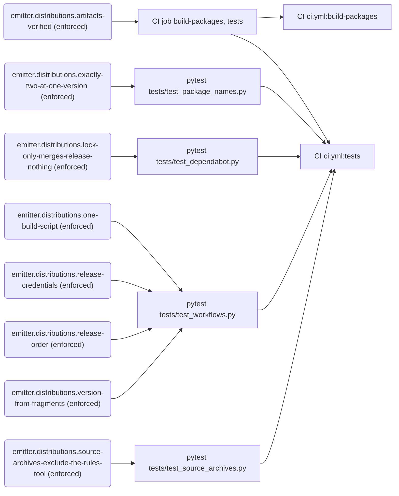
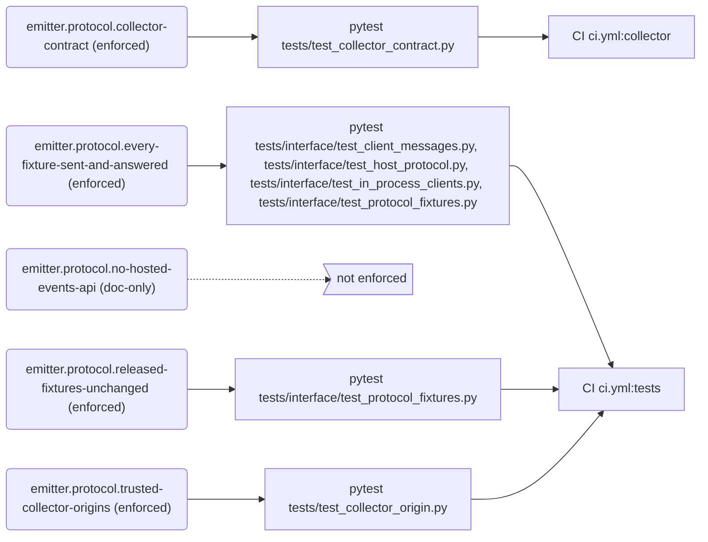
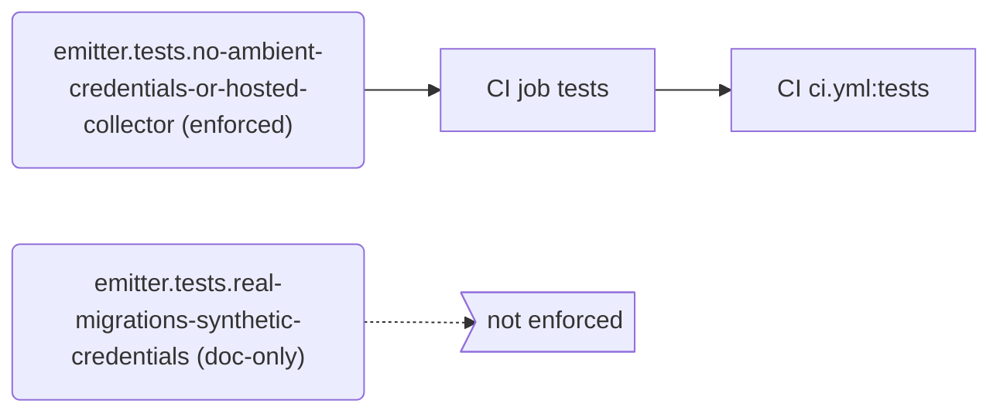
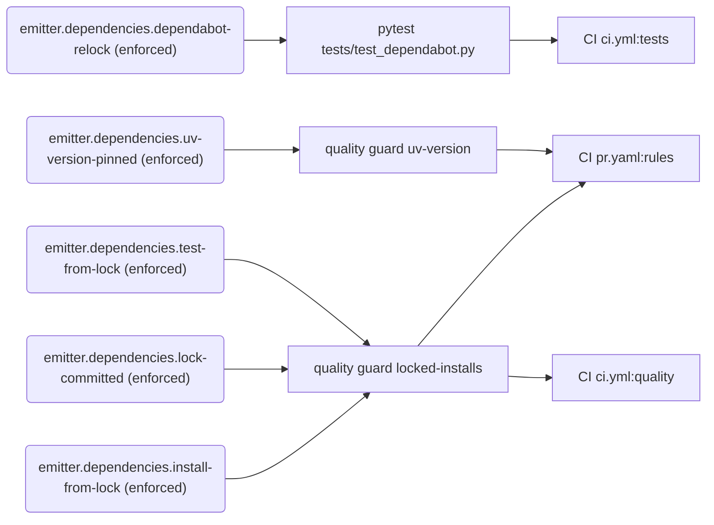
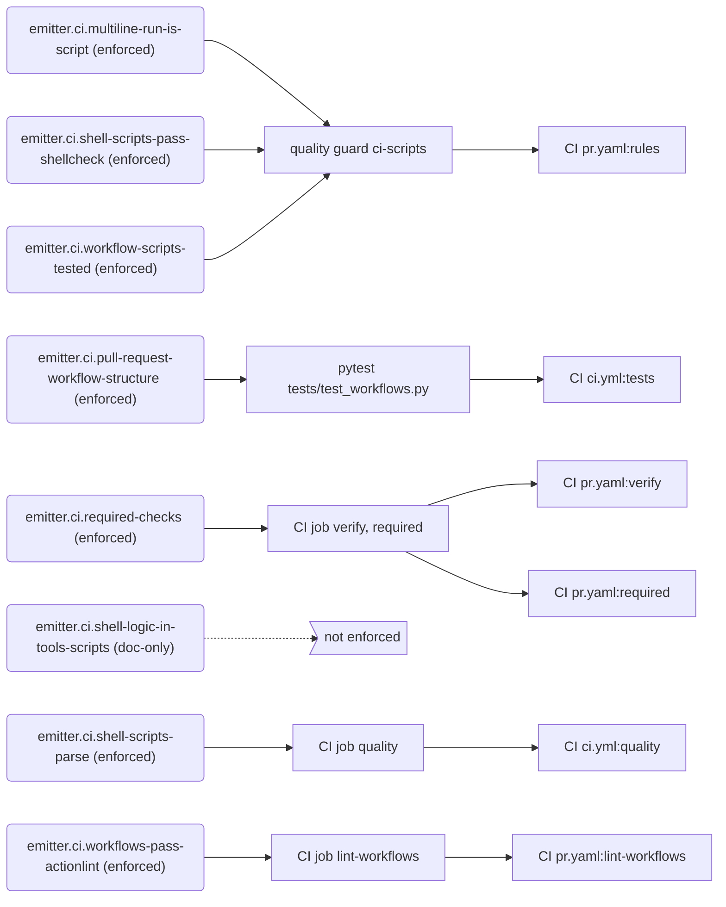
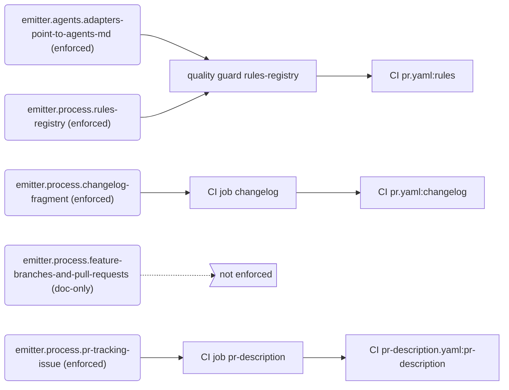

# Rules

Generated by `python -m scripts.rules render` from `rules/registry.toml`. Do not edit by hand.

Every rule that governs `microcosm-emitter` is listed here with how it is enforced. Blocking rules fail CI. The Gaps section lists what is written down but not yet enforced or proven. To add or change a rule, see `docs/engineering/skills/rules-registry.md`.

## Summary

| Tier | enforced | ratcheted | advisory | doc-only | Total |
| --- | ---: | ---: | ---: | ---: | ---: |
| mechanical | 47 | 0 | 0 | 7 | 54 |
| metric | 1 | 0 | 0 | 0 | 1 |
| judgment | 0 | 0 | 0 | 0 | 0 |

**Blocking:** 48 of 55 rules.

## Gaps

### Not enforced (doc-only)

- `emitter.ci.shell-logic-in-tools-scripts`: Shell logic of several commands lives in a Bash script under tools/, which a workflow step calls with a single command, and a test runs that script, with fake commands in place of anything it would change or reach outside the test.
- `emitter.persistence.sqlalchemy-and-alembic-only`: Python databases use the SQLAlchemy declarative ORM and Alembic only: no handwritten SQL or direct-driver persistence in any form, no schema repair and no adoption of databases made before Alembic.
- `emitter.persistence.typescript-uses-drizzle`: TypeScript database code, if any is added, uses Drizzle ORM and Drizzle Kit migrations.
- `emitter.process.feature-branches-and-pull-requests`: Push feature branches and open pull requests; never push to main directly, merge automatically or monitor queued checks.
- `emitter.protocol.no-hosted-events-api`: Preserve the existing collector protocol, and do not add a general hosted events API.
- `emitter.quality.toolchain`: Use uv, Python 3.13 or later, pytest and Ruff.
- `emitter.tests.real-migrations-synthetic-credentials`: Tests use temporary databases created through real migrations, synthetic credentials and loopback network services, and contact no hosted collector through any client, including the HTTP clients of the submissions client and the Orrery queue, which tests/conftest.py does not intercept.

### Advisory (checked but not blocking)

- None.

### Unproven (no proof that the checker rejects a bad example)

- `emitter.boundaries.graph-adapter-imports-no-service-code`
- `emitter.boundaries.host-imports-no-domain-code`
- `emitter.boundaries.interface-imports-only-the-standard-library`
- `emitter.boundaries.public-credential-lookup`
- `emitter.boundaries.shared-definitions-written-once`
- `emitter.boundaries.telemetry-client-imports-no-service-code`
- `emitter.ci.pull-request-workflow-structure`
- `emitter.dependencies.dependabot-relock`
- `emitter.distributions.exactly-two-at-one-version`
- `emitter.distributions.lock-only-merges-release-nothing`
- `emitter.distributions.one-build-script`
- `emitter.distributions.release-credentials`
- `emitter.distributions.release-order`
- `emitter.distributions.source-archives-exclude-the-rules-tool`
- `emitter.distributions.version-from-fragments`
- `emitter.persistence.no-raw-sql-or-schema-calls`
- `emitter.process.rules-registry`
- `emitter.protocol.collector-contract`
- `emitter.protocol.every-fixture-sent-and-answered`
- `emitter.protocol.released-fixtures-unchanged`
- `emitter.protocol.trusted-collector-origins`
- `emitter.quality.runtime-evaluated-models-resolve`

### Ratcheted (existing violations still tolerated)

- None.

### Exceptions and review dates

- `emitter.dependencies.install-from-lock`: exception for `.github/workflows/pr-description.yaml` (`uv run --no-project python -m scripts.rules.pr_description`); remove when scripts/rules needs a package beyond the standard library (The PR description check is part of the rules tool, which uses only the standard library, so it runs without installing the project.)
- `emitter.dependencies.install-from-lock`: exception for `.github/workflows/pr.yaml` (`uv run --no-project python -m unittest discover -s scripts/rules/tests`); remove when scripts/rules needs a package beyond the standard library (The rules tool uses only the standard library, so its tests run without installing the project.)
- `emitter.dependencies.install-from-lock`: exception for `.github/workflows/pr.yaml` (`uv run --no-project python scripts/run_quality_guards.py`); remove when scripts/rules needs a package beyond the standard library (The quality guards are the rules tool, which uses only the standard library, so they run without installing the project.)
- `emitter.dependencies.install-from-lock`: exception for `.github/workflows/pr.yaml` (`uv tool install shellcheck-py==0.11.0.1`) [pinned-tool] (shellcheck is a binary the ci-scripts tests run; the rules job has no project environment, so it installs the exact shellcheck-py release.)
- `emitter.dependencies.install-from-lock`: exception for `tools/check-changelog.sh` (`uv run --no-project python tools/bump-version.py --check`); remove when tools/bump-version.py needs a package beyond the standard library (tools/bump-version.py uses only the standard library, so the changelog job checks fragments without installing the project.)
- `emitter.dependencies.install-from-lock`: exception for `tools/check-collector.sh` (`uv pip install --reinstall --no-deps dist/*.whl`); remove when the contract test no longer tests the built wheels (The contract test tests the wheels build-packages built, so they replace the workspace's editable installs; their dependencies come from the locked environment uv sync --locked installed first.)
- `emitter.dependencies.install-from-lock`: exception for `tools/check-collector.sh` (`uv pip install -e .collector/telemetry-service`); remove when the contract test no longer installs the pinned collector from its source (The collector contract test runs against calibration-diagnostics' telemetry-service at the commit the script pins, which is no part of this workspace or its uv.lock.)
- `emitter.dependencies.install-from-lock`: exception for `tools/check-collector.sh` (`uv run --no-sync pytest tests/test_collector_contract.py`); remove when the contract test no longer tests the built wheels (Syncing would replace the installed wheels with the workspace sources, so the contract test runs in the locked environment without syncing it again.)
- `emitter.dependencies.install-from-lock`: exception for `tools/check-installed.py` (`uv pip install --python`); remove when the check no longer reproduces a user's install (The installed-artifact check installs the built wheels into two clean environments as uv tool install microcosm-emitter does for a user, so it resolves their runtime dependencies from PyPI afresh: it tests what a user installing this release gets today, not the locked versions.)
- `emitter.dependencies.install-from-lock`: exception for `tools/update-version.sh` (`uv run --no-project python tools/bump-version.py`); remove when tools/bump-version.py needs a package beyond the standard library (tools/bump-version.py uses only the standard library, so the release bumps the version before uv lock records it, without installing the project.)
- `emitter.dependencies.install-from-lock`: exception for `tools/update-version.sh` (`uvx --from towncrier==26.9.0`) [pinned-tool] (towncrier builds the changelog at release time and is no dependency of either distribution, so the release runs the exact towncrier release.)
- `emitter.dependencies.test-from-lock`: exception for `.github/workflows/pr.yaml` (`python -m unittest discover -s scripts/rules/tests`); remove when scripts/rules needs a package beyond the standard library (The rules tool uses only the standard library and is no part of either distribution, so its tests run without the project's locked environment.)
- `emitter.dependencies.test-from-lock`: exception for `tools/check-collector.sh` (`uv run --no-sync pytest tests/test_collector_contract.py`); remove when the contract test no longer tests the built wheels (Syncing would replace the installed wheels with the workspace sources, so the contract test runs in the locked environment without syncing it again.)

## Runtime and package boundaries

| Rule | Statement | Tier | Status | Blocking | Enforced by | CI | Proof |
| --- | --- | --- | --- | --- | --- | --- | --- |
| `emitter.boundaries.graph-adapter-imports-no-service-code` | Graph adapters, the Orrery client and its contracts, import no service, database, authentication or HTTP code: inventory hashing, durable enqueue, receipt lookup and retries run in the separate local emitter service, and the client never falls back to writing the database directly. | mechanical | enforced | yes | pytest `tests/orrery/test_client.py`, `tests/test_boundaries.py` | `ci.yml:tests` | **unproven** |
| `emitter.boundaries.host-imports-no-domain-code` | The generic runtime, microcosm_emitter.host, imports no telemetry, Orrery, database or authentication code, no Microcosm, SQLAlchemy, Alembic or Hugging Face Hub module, and not the interface package. | mechanical | enforced | yes | pytest `tests/test_boundaries.py` | `ci.yml:tests` | **unproven** |
| `emitter.boundaries.interface-imports-only-the-standard-library` | The interface package imports only the standard library and itself, and importing it loads no microcosm_emitter module. | mechanical | enforced | yes | pytest `tests/test_boundaries.py` | `ci.yml:tests` | **unproven** |
| `emitter.boundaries.public-credential-lookup` | Code reads the Hugging Face credential through core.auth.huggingface_token; no module imports the private _huggingface_token. | mechanical | enforced | yes | pytest `tests/test_boundaries.py` | `ci.yml:tests` | **unproven** |
| `emitter.boundaries.shared-definitions-written-once` | What both packages use is defined once: the emitter's in-process clients reuse the interface's TelemetryRun, wire_value, Orrery publication types and default_spool_path rather than copies, and each hand-over failure code and limit the packages share is assigned at module level exactly once across both. | mechanical | enforced | yes | pytest `tests/interface/test_in_process_clients.py`, `tests/test_boundaries.py` | `ci.yml:tests` | **unproven** |
| `emitter.boundaries.telemetry-client-imports-no-service-code` | The telemetry client, microcosm_emitter.telemetry outside its service package, imports no service implementation, database or authentication module, and importing the public modules opens no socket, starts no process and creates no directory. | mechanical | enforced | yes | pytest `tests/test_boundaries.py` | `ci.yml:tests` | **unproven** |

## Databases and migrations

| Rule | Statement | Tier | Status | Blocking | Enforced by | CI | Proof |
| --- | --- | --- | --- | --- | --- | --- | --- |
| `emitter.persistence.no-raw-sql-or-schema-calls` | No module under src/microcosm_emitter calls a function or method named create_all, exec_driver_sql, executescript or text, or imports sqlite3, psycopg or psycopg2 in the form import <module>. | mechanical | enforced | yes | pytest `tests/test_boundaries.py` | `ci.yml:tests` | **unproven** |
| `emitter.persistence.sqlalchemy-and-alembic-only` | Python databases use the SQLAlchemy declarative ORM and Alembic only: no handwritten SQL or direct-driver persistence in any form, no schema repair and no adoption of databases made before Alembic. | mechanical | doc-only | no | nothing | — | — |
| `emitter.persistence.typescript-uses-drizzle` | TypeScript database code, if any is added, uses Drizzle ORM and Drizzle Kit migrations. | mechanical | doc-only | no | nothing | — | — |

## Distributions and releases

| Rule | Statement | Tier | Status | Blocking | Enforced by | CI | Proof |
| --- | --- | --- | --- | --- | --- | --- | --- |
| `emitter.distributions.artifacts-verified` | Every pull request builds both distributions, each wheel from its source archive, and checks them: twine check --strict passes; tools/check-installed.py finds one wheel and one source archive per distribution, refuses a source archive holding the rules tool, and installs the wheels into two clean environments outside the checkout without Hugging Face credentials; in the emitter's, Microcosm is absent, the project URL is the repository, importing the host and the Orrery client loads no database, Hugging Face, telemetry or service module, and telemetry-only, graph-only, combined and failing services start and record their events and graph jobs in an event queue database at Alembic revision 20261008_02; in a build's, which holds only the interface, the interface has no requirements and ships its protocol fixtures, and the installed emitter it starts reports the interface's version and the telemetry, Orrery and Hugging Face modules, accepts telemetry, an Orrery hand-over and a run-file staging request, and exits with status 0. | mechanical | enforced | yes | CI job `build-packages`, `tests` | `ci.yml:build-packages`, `ci.yml:tests` | — |
| `emitter.distributions.exactly-two-at-one-version` | The repository publishes exactly two distributions, always together and at one version: microcosm-emitter, which installs the generic host and its required telemetry with no extras, and the dependency-free microcosm-emitter-interface, which microcosm-emitter==X requires at ==X; there are no standalone telemetry packages, optional telemetry installs or further distributions. | mechanical | enforced | yes | pytest `tests/test_package_names.py` | `ci.yml:tests` | **unproven** |
| `emitter.distributions.lock-only-merges-release-nothing` | A Dependabot pull request that changes only uv.lock needs no changelog fragment, since it changes no published package's requirements, and a merge without fragments releases nothing: tools/update-version.sh changes no file and push.yaml makes no version commit, so nothing is tagged or published. | mechanical | enforced | yes | pytest `tests/test_dependabot.py` | `ci.yml:tests` | **unproven** |
| `emitter.distributions.one-build-script` | Only tools/check-artifacts.sh builds the distributions, with one uv build --all-packages into a dist directory it removes beforehand and no --clear, no workflow runs uv build itself, and tools/check-installed.py checks the interface wheel apart from the emitter. | mechanical | enforced | yes | pytest `tests/test_workflows.py` | `ci.yml:tests` | **unproven** |
| `emitter.distributions.release-credentials` | In push.yaml only the publish job, in the pypi environment, may request an OpenID Connect token, and the workflow reads no secrets but APP_ID and APP_PRIVATE_KEY, once each, for the GitHub App token that commits the version. | mechanical | enforced | yes | pytest `tests/test_workflows.py` | `ci.yml:tests` | **unproven** |
| `emitter.distributions.release-order` | push.yaml releases a merge to main in order (the version commit, then ci.yml on that commit, then the tag, then publication) and publishes to PyPI only the artifacts ci.yml built, one per distribution, the interface first, skipping files PyPI already holds so a rerun completes a partial upload. | mechanical | enforced | yes | pytest `tests/test_workflows.py` | `ci.yml:tests` | **unproven** |
| `emitter.distributions.source-archives-exclude-the-rules-tool` | The microcosm-emitter source archive leaves out the rules tool, the registry and their documents, and tools/check-installed.py refuses either source archive if it holds any of them, naming the same paths the build excludes. | mechanical | enforced | yes | pytest `tests/test_source_archives.py` | `ci.yml:tests` | **unproven** |
| `emitter.distributions.version-from-fragments` | A release's version bump follows its changelog fragment types (breaking is a major bump, added or removed a minor bump, anything else a patch bump) and rewrites both distributions' versions and the interface pin together, and the release refuses diverged versions, a different pin, missing or untyped fragments, and a missing or repeated version line. | mechanical | enforced | yes | pytest `tests/test_workflows.py` | `ci.yml:tests` | **unproven** |

## Collector protocol

| Rule | Statement | Tier | Status | Blocking | Enforced by | CI | Proof |
| --- | --- | --- | --- | --- | --- | --- | --- |
| `emitter.protocol.collector-contract` | The installed wheels deliver telemetry to the collector at the commit tools/check-collector.sh pins, with a disposable PostgreSQL database: events become dashboard documents, rejected identities register nothing, a lost acknowledgement is retried without duplicates, and blocked outcomes and supplied failure codes survive. | mechanical | enforced | yes | pytest `tests/test_collector_contract.py` | `ci.yml:collector` | **unproven** |
| `emitter.protocol.every-fixture-sent-and-answered` | Every protocol fixture has an interface test that produces it, from a typed call, a module configuration or a host request, and this emitter answers each one: the telemetry, Orrery and Hugging Face modules handle their message and query fixtures, the installed command starts from the launch fixture and answers hello with at least the recorded keys, and the host routes each envelope fixture to its module. | mechanical | enforced | yes | pytest `tests/interface/test_client_messages.py`, `tests/interface/test_host_protocol.py`, `tests/interface/test_in_process_clients.py`, `tests/interface/test_protocol_fixtures.py` | `ci.yml:tests` | **unproven** |
| `emitter.protocol.no-hosted-events-api` | Preserve the existing collector protocol, and do not add a general hosted events API. | mechanical | doc-only | no | nothing | — | — |
| `emitter.protocol.released-fixtures-unchanged` | A released protocol fixture is never edited or removed, since each one's SHA-256 is pinned, and every fixture's protocol version is one this emitter accepts. | mechanical | enforced | yes | pytest `tests/interface/test_protocol_fixtures.py` | `ci.yml:tests` | **unproven** |
| `emitter.protocol.trusted-collector-origins` | Every trusted collector origin is a bare HTTPS origin that a module configuration selects as itself, with or without a trailing slash. | mechanical | enforced | yes | pytest `tests/test_collector_origin.py` | `ci.yml:tests` | **unproven** |

## Test isolation

| Rule | Statement | Tier | Status | Blocking | Enforced by | CI | Proof |
| --- | --- | --- | --- | --- | --- | --- | --- |
| `emitter.tests.no-ambient-credentials-or-hosted-collector` | Tests never use ambient Hugging Face credentials, and never send a telemetry or authentication request to a hosted collector: an autouse fixture in tests/conftest.py removes the Hugging Face credential variables, gives each test a temporary Hugging Face home, and fails a test whose telemetry or authentication request names a host other than loopback. | mechanical | enforced | yes | CI job `tests` | `ci.yml:tests` | — |
| `emitter.tests.real-migrations-synthetic-credentials` | Tests use temporary databases created through real migrations, synthetic credentials and loopback network services, and contact no hosted collector through any client, including the HTTP clients of the submissions client and the Orrery queue, which tests/conftest.py does not intercept. | mechanical | doc-only | no | nothing | — | — |

## Code quality

| Rule | Statement | Tier | Status | Blocking | Enforced by | CI | Proof |
| --- | --- | --- | --- | --- | --- | --- | --- |
| `emitter.quality.command-line-scripts-ruff-exemptions` | Command-line scripts under scripts/ may print their output (T201), run other programs (S603, S607) and use today's date (DTZ011); every other Ruff rule applies to them. | mechanical | enforced | yes | ruff per-file ignore of DTZ011, S603, S607, T201 for `scripts/**` | `ci.yml:quality` | — |
| `emitter.quality.installed-checks-ruff-exemptions` | The installed-artifact checks (tools/check-installed.py, tools/installed-smoke.py and tools/installed-interface-smoke.py) assert, as tests do (S101), import inside each check to test what that import loads (PLC0415), and read the clients' private members to check the processes they started (SLF001). | mechanical | enforced | yes | ruff per-file ignore of PLC0415, S101, SLF001 for `tools/{check-installed,installed-smoke,installed-interface-smoke}.py` | `ci.yml:quality` | — |
| `emitter.quality.program-ruff-exemptions` | The modules that run as command-line programs, microcosm_emitter.cli and microcosm_emitter.host.__main__, may print their output (T201), as the Public API's modules that run as programs do; every other Ruff rule applies to them. | mechanical | enforced | yes | ruff per-file ignore of T201 for `src/microcosm_emitter/{cli,host/__main__}.py` | `ci.yml:quality` | — |
| `emitter.quality.python-file-length` | No tracked Python file has more than 800 lines, or more than 1,500 if it is test code: a file under tests/ or under the rules tool's tests and fixtures, scripts/rules/tests/. | metric | enforced | yes | quality guard `file-length` | `pr.yaml:rules` | yes |
| `emitter.quality.ruff-format` | All Python is formatted with ruff format. | mechanical | enforced | yes | ruff format | `ci.yml:quality` | — |
| `emitter.quality.ruff-lint` | All Python passes ruff check with every Ruff rule selected (ALL), as in the simulation API and the Public API, except COM812 and ISC001, which conflict with ruff format, D203 and D213, which conflict with D211 and D212, CPY, which Ruff 0.16 makes stable but their Ruff 0.15 keeps in preview, the registered per-file ignores, and, until the pull requests stacked on #55 fix them, the families pyproject.toml lists as not fixed yet. | mechanical | enforced | yes | ruff check (ALL) | `ci.yml:quality` | — |
| `emitter.quality.rules-tool-tests-pass` | The rules tool's own tests, the unittest tests under scripts/rules/tests, pass in pr.yaml's rules job, on Ubuntu with Python 3.13 and only the standard library. | mechanical | enforced | yes | CI job `rules` | `pr.yaml:rules` | — |
| `emitter.quality.runtime-evaluated-models-resolve` | Every SQLAlchemy model in microcosm_emitter is one Ruff treats as runtime-evaluated (a base resolves, through the import in its own module, to a name in runtime-evaluated-base-classes, or is a same-module class that does), and every mapper configures once the package is imported, as in the simulation API and the Public API. | mechanical | enforced | yes | pytest `tests/test_runtime_evaluated_annotations.py` | `ci.yml:tests` | **unproven** |
| `emitter.quality.tests-pass` | Every pytest test under tests/ except the collector contract test passes in ci.yml's tests job, on Ubuntu and macOS with Python 3.13 and 3.14, in the environment uv sync --locked installs. | mechanical | enforced | yes | CI job `tests` | `ci.yml:tests` | — |
| `emitter.quality.tests-ruff-exemptions` | Test files may use pytest's bare assert, need no docstrings, annotations or named constants for magic numbers, and may reach into private members, live in directories that aren't packages, import inside a test, import the lazily loaded modules at module level, and use fake credentials, temporary paths, naive datetimes, string-built SQL, prints and subprocess calls to repository scripts (ANN, D1, S101, PLR2004, SLF001, INP001, PLC0415, TID253, S105, S106, S108, S608, DTZ001, DTZ011, T201, S603, S607), may name a fake's methods after the interface it replaces (N802), and may leave a stand-in's arguments unused (ARG001, ARG002, ARG005), as in the Public API and the simulation API; every other Ruff rule applies to tests. | mechanical | enforced | yes | ruff per-file ignore of ANN, ARG001, ARG002, ARG005, D1, DTZ001, DTZ011, INP001, N802, PLC0415, PLR2004, S101, S105, S106, S108, S603, S607, S608, SLF001, T201, TID253 for `**/tests/**` | `ci.yml:quality` | — |
| `emitter.quality.toolchain` | Use uv, Python 3.13 or later, pytest and Ruff. | mechanical | doc-only | no | nothing | — | — |
| `emitter.quality.tools-ruff-exemptions` | The Python scripts under tools/, which CI runs, may have hyphenated file names (N999), print their results (T201) and run other programs (S603); every other Ruff rule applies to them. | mechanical | enforced | yes | ruff per-file ignore of N999, S603, T201 for `tools/**` | `ci.yml:quality` | — |
| `emitter.quality.unittest-ruff-exemptions` | The rules tool's tests use unittest, because the tool needs only the standard library, so Ruff's pytest-style rules (PT) don't apply to them. | mechanical | enforced | yes | ruff per-file ignore of PT for `scripts/rules/tests/**` | `ci.yml:quality` | — |

```mermaid
flowchart LR
  r_emitter_quality_command_line_scripts_ruff_exemptions("emitter.quality.command-line-scripts-ruff-exemptions (enforced)")
  e_ruff_per_file_ignore_of_DTZ011__S603__S607__T201_for_scripts___["ruff per-file ignore of DTZ011, S603, S607, T201 for scripts/**"]
  j_CI_ci_yml_quality["CI ci.yml:quality"]
  r_emitter_quality_installed_checks_ruff_exemptions("emitter.quality.installed-checks-ruff-exemptions (enforced)")
  e_ruff_per_file_ignore_of_PLC0415__S101__SLF001_for_tools__check_installed_installed_smoke_installed_interface_smoke__py["ruff per-file ignore of PLC0415, S101, SLF001 for tools/{check-installed,installed-smoke,installed-interface-smoke}.py"]
  r_emitter_quality_program_ruff_exemptions("emitter.quality.program-ruff-exemptions (enforced)")
  e_ruff_per_file_ignore_of_T201_for_src_microcosm_emitter__cli_host___main____py["ruff per-file ignore of T201 for src/microcosm_emitter/{cli,host/__main__}.py"]
  r_emitter_quality_python_file_length("emitter.quality.python-file-length (enforced)")
  e_quality_guard_file_length["quality guard file-length"]
  j_CI_pr_yaml_rules["CI pr.yaml:rules"]
  r_emitter_quality_ruff_format("emitter.quality.ruff-format (enforced)")
  e_ruff_format["ruff format"]
  r_emitter_quality_ruff_lint("emitter.quality.ruff-lint (enforced)")
  e_ruff_check__ALL_["ruff check (ALL)"]
  r_emitter_quality_rules_tool_tests_pass("emitter.quality.rules-tool-tests-pass (enforced)")
  e_CI_job_rules["CI job rules"]
  r_emitter_quality_runtime_evaluated_models_resolve("emitter.quality.runtime-evaluated-models-resolve (enforced)")
  e_pytest_tests_test_runtime_evaluated_annotations_py["pytest tests/test_runtime_evaluated_annotations.py"]
  j_CI_ci_yml_tests["CI ci.yml:tests"]
  r_emitter_quality_tests_pass("emitter.quality.tests-pass (enforced)")
  e_CI_job_tests["CI job tests"]
  r_emitter_quality_tests_ruff_exemptions("emitter.quality.tests-ruff-exemptions (enforced)")
  e_ruff_per_file_ignore_of_ANN__ARG001__ARG002__ARG005__D1__DTZ001__DTZ011__INP001__N802__PLC0415__PLR2004__S101__S105__S106__S108__S603__S607__S608__SLF001__T201__TID253_for____tests___["ruff per-file ignore of ANN, ARG001, ARG002, ARG005, D1, DTZ001, DTZ011, INP001, N802, PLC0415, PLR2004, S101, S105, S106, S108, S603, S607, S608, SLF001, T201, TID253 for **/tests/**"]
  r_emitter_quality_toolchain("emitter.quality.toolchain (doc-only)")
  gap_unenforced>"not enforced"]
  r_emitter_quality_tools_ruff_exemptions("emitter.quality.tools-ruff-exemptions (enforced)")
  e_ruff_per_file_ignore_of_N999__S603__T201_for_tools___["ruff per-file ignore of N999, S603, T201 for tools/**"]
  r_emitter_quality_unittest_ruff_exemptions("emitter.quality.unittest-ruff-exemptions (enforced)")
  e_ruff_per_file_ignore_of_PT_for_scripts_rules_tests___["ruff per-file ignore of PT for scripts/rules/tests/**"]
  r_emitter_quality_command_line_scripts_ruff_exemptions --> e_ruff_per_file_ignore_of_DTZ011__S603__S607__T201_for_scripts___
  e_ruff_per_file_ignore_of_DTZ011__S603__S607__T201_for_scripts___ --> j_CI_ci_yml_quality
  r_emitter_quality_installed_checks_ruff_exemptions --> e_ruff_per_file_ignore_of_PLC0415__S101__SLF001_for_tools__check_installed_installed_smoke_installed_interface_smoke__py
  e_ruff_per_file_ignore_of_PLC0415__S101__SLF001_for_tools__check_installed_installed_smoke_installed_interface_smoke__py --> j_CI_ci_yml_quality
  r_emitter_quality_program_ruff_exemptions --> e_ruff_per_file_ignore_of_T201_for_src_microcosm_emitter__cli_host___main____py
  e_ruff_per_file_ignore_of_T201_for_src_microcosm_emitter__cli_host___main____py --> j_CI_ci_yml_quality
  r_emitter_quality_python_file_length --> e_quality_guard_file_length
  e_quality_guard_file_length --> j_CI_pr_yaml_rules
  r_emitter_quality_ruff_format --> e_ruff_format
  e_ruff_format --> j_CI_ci_yml_quality
  r_emitter_quality_ruff_lint --> e_ruff_check__ALL_
  e_ruff_check__ALL_ --> j_CI_ci_yml_quality
  r_emitter_quality_rules_tool_tests_pass --> e_CI_job_rules
  e_CI_job_rules --> j_CI_pr_yaml_rules
  r_emitter_quality_runtime_evaluated_models_resolve --> e_pytest_tests_test_runtime_evaluated_annotations_py
  e_pytest_tests_test_runtime_evaluated_annotations_py --> j_CI_ci_yml_tests
  r_emitter_quality_tests_pass --> e_CI_job_tests
  e_CI_job_tests --> j_CI_ci_yml_tests
  r_emitter_quality_tests_ruff_exemptions --> e_ruff_per_file_ignore_of_ANN__ARG001__ARG002__ARG005__D1__DTZ001__DTZ011__INP001__N802__PLC0415__PLR2004__S101__S105__S106__S108__S603__S607__S608__SLF001__T201__TID253_for____tests___
  e_ruff_per_file_ignore_of_ANN__ARG001__ARG002__ARG005__D1__DTZ001__DTZ011__INP001__N802__PLC0415__PLR2004__S101__S105__S106__S108__S603__S607__S608__SLF001__T201__TID253_for____tests___ --> j_CI_ci_yml_quality
  r_emitter_quality_toolchain -.-> gap_unenforced
  r_emitter_quality_tools_ruff_exemptions --> e_ruff_per_file_ignore_of_N999__S603__T201_for_tools___
  e_ruff_per_file_ignore_of_N999__S603__T201_for_tools___ --> j_CI_ci_yml_quality
  r_emitter_quality_unittest_ruff_exemptions --> e_ruff_per_file_ignore_of_PT_for_scripts_rules_tests___
  e_ruff_per_file_ignore_of_PT_for_scripts_rules_tests___ --> j_CI_ci_yml_quality
```

## Dependency locking

| Rule | Statement | Tier | Status | Blocking | Enforced by | CI | Proof |
| --- | --- | --- | --- | --- | --- | --- | --- |
| `emitter.dependencies.dependabot-relock` | Dependabot proposes uv.lock updates every week, for the uv ecosystem at the repository root, as one grouped pull request that changes only uv.lock (versioning-strategy lockfile-only); it runs on GitHub's side with its own credentials, so no secret of this repository reaches the code resolving runs. | mechanical | enforced | yes | pytest `tests/test_dependabot.py` | `ci.yml:tests` | **unproven** |
| `emitter.dependencies.install-from-lock` | Every install of the project's Python dependencies, in workflows, the shell scripts under tools/ they run and the commands the Python scripts under tools/ start, installs exactly the locked versions (uv sync --locked, uv run --locked); any other install is a registered exception for that one site. | mechanical | enforced | yes | quality guard `locked-installs` | `pr.yaml:rules` | yes |
| `emitter.dependencies.lock-committed` | Every project directory with a pyproject.toml commits a uv.lock that matches it, or is a member of the uv workspace whose uv.lock locks it, and a pull-request job checks the lock with uv lock --check. | mechanical | enforced | yes | quality guard `locked-installs` | `pr.yaml:rules`, `ci.yml:quality` | yes |
| `emitter.dependencies.test-from-lock` | Every test command (pytest, python -m unittest) in workflows, the shell scripts under tools/ they run and the commands the Python scripts under tools/ start runs through uv run --locked, in the locked environment; any other test run is a registered exception for that one site. | mechanical | enforced | yes | quality guard `locked-installs` | `pr.yaml:rules` | yes |
| `emitter.dependencies.uv-version-pinned` | The one uv release is written once, as the line uv==X.Y.Z in .github/uv-version.txt: each astral-sh/setup-uv step reads it with version-file and writes no version:, any uv container image, install script, release download or package install of uv names it, and the root pyproject.toml's [tool.uv] required-version is a lower bound (>=X.Y) it meets, so an older uv refuses the project while Dependabot's uv still runs. | mechanical | enforced | yes | quality guard `uv-version` | `pr.yaml:rules` | yes |

## CI workflows and scripts

| Rule | Statement | Tier | Status | Blocking | Enforced by | CI | Proof |
| --- | --- | --- | --- | --- | --- | --- | --- |
| `emitter.ci.multiline-run-is-script` | Every workflow run: step holds one command: one line of code, with no commands chained by &&, \|\| or ;. | mechanical | enforced | yes | quality guard `ci-scripts` | `pr.yaml:rules` | yes |
| `emitter.ci.pull-request-workflow-structure` | pr.yaml runs on pull requests and calls ci.yml, the changelog check and the rules registry, and its Required checks job runs always and needs each other job; ci.yml is called only by other workflows and has exactly the quality, tests, build-packages and collector jobs, testing on Ubuntu and macOS with Python 3.13 and 3.14, with the collector job after build-packages; pr-description.yaml runs for open pull requests whose base, or whose stack's final target, is main, on every event that can change the description, with read-only permissions, in one job named PR description. | mechanical | enforced | yes | pytest `tests/test_workflows.py` | `ci.yml:tests` | **unproven** |
| `emitter.ci.required-checks` | Every pull request runs the verification workflow, ci.yml, and Required checks, a status check main's ruleset requires, passes only when every other pr.yaml job succeeded. | mechanical | enforced | yes | CI job `verify`, `required` | `pr.yaml:verify`, `pr.yaml:required` | — |
| `emitter.ci.shell-logic-in-tools-scripts` | Shell logic of several commands lives in a Bash script under tools/, which a workflow step calls with a single command, and a test runs that script, with fake commands in place of anything it would change or reach outside the test. | mechanical | doc-only | no | nothing | — | — |
| `emitter.ci.shell-scripts-parse` | Every shell script under tools/ parses (bash -n). | mechanical | enforced | yes | CI job `quality` | `ci.yml:quality` | — |
| `emitter.ci.shell-scripts-pass-shellcheck` | Every shell script under tools/ passes shellcheck, which the Rules registry job installs as shellcheck-py 0.11.0.1. | mechanical | enforced | yes | quality guard `ci-scripts` | `pr.yaml:rules` | yes |
| `emitter.ci.workflow-scripts-tested` | Every shell script under tools/ that a workflow calls is named in a test file under tests/. | mechanical | enforced | yes | quality guard `ci-scripts` | `pr.yaml:rules` | yes |
| `emitter.ci.workflows-pass-actionlint` | Every workflow passes actionlint 1.7.12, which also runs shellcheck on each run: step. | mechanical | enforced | yes | CI job `lint-workflows` | `pr.yaml:lint-workflows` | — |

## Process and repository hygiene

| Rule | Statement | Tier | Status | Blocking | Enforced by | CI | Proof |
| --- | --- | --- | --- | --- | --- | --- | --- |
| `emitter.agents.adapters-point-to-agents-md` | CLAUDE.md only points to AGENTS.md; guidance and rules are written in AGENTS.md alone. | mechanical | enforced | yes | quality guard `rules-registry` | `pr.yaml:rules` | yes |
| `emitter.process.changelog-fragment` | Every pull request adds at least one changelog fragment, changelog.d/<name>.<type>.md with a type of breaking, added, changed, fixed or removed, and keeps both distributions' versions and the interface pin consistent, so its merge can be released; a Dependabot pull request that changes only uv.lock is the exception. | mechanical | enforced | yes | CI job `changelog` | `pr.yaml:changelog` | — |
| `emitter.process.feature-branches-and-pull-requests` | Push feature branches and open pull requests; never push to main directly, merge automatically or monitor queued checks. | mechanical | doc-only | no | nothing | — | — |
| `emitter.process.pr-tracking-issue` | The first line of the description of every open pull request whose base, or whose stack's final target, is main is Fixes #ISSUE_NUMBER, naming an open issue, not a pull request, in this repository; a pull request Dependabot opens is the exception. | mechanical | enforced | yes | CI job `pr-description` | `pr-description.yaml:pr-description` | yes |
| `emitter.process.rules-registry` | Every rule is registered in rules/registry.toml, is enforced where it claims to be, and its rendered views are current. | mechanical | enforced | yes | quality guard `rules-registry` | `pr.yaml:rules` | **unproven** |

