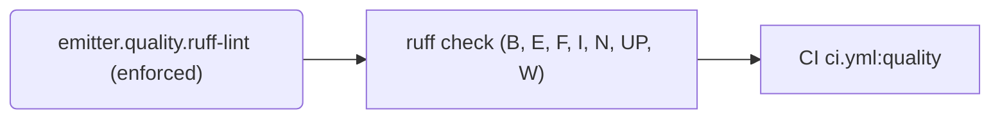
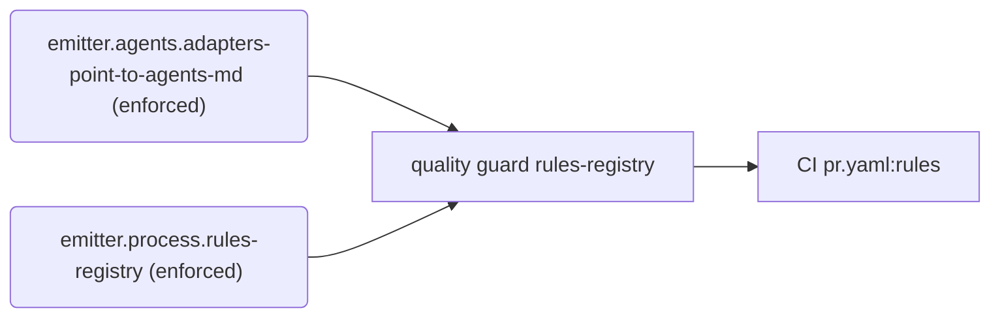

# Rules

Generated by `python -m scripts.rules render` from `rules/registry.toml`. Do not edit by hand.

Every rule registered for `microcosm-emitter` in `rules/registry.toml` is listed here with how it is enforced. Blocking rules fail CI. The Gaps section lists what is written down but not yet enforced or proven. To add or change a rule, see `docs/engineering/skills/rules-registry.md`.

## Summary

| Tier | enforced | ratcheted | advisory | doc-only | Total |
| --- | ---: | ---: | ---: | ---: | ---: |
| mechanical | 3 | 0 | 0 | 0 | 3 |
| metric | 0 | 0 | 0 | 0 | 0 |
| judgment | 0 | 0 | 0 | 0 | 0 |

**Blocking:** 3 of 3 rules.

## Gaps

### Not enforced (doc-only)

- None.

### Advisory (checked but not blocking)

- None.

### Unproven (no proof that the checker rejects a bad example)

- `emitter.process.rules-registry`

### Ratcheted (existing violations still tolerated)

- None.

### Exceptions and review dates

- None.

## Code quality

| Rule | Statement | Tier | Status | Blocking | Enforced by | CI | Proof |
| --- | --- | --- | --- | --- | --- | --- | --- |
| `emitter.quality.ruff-lint` | All Python passes ruff check with the rule families E, F, I, N, W, UP and B selected, except E501 (line length), which ruff format settles. | mechanical | enforced | yes | ruff check (B, E, F, I, N, UP, W) | `ci.yml:quality` | — |

## Process and repository hygiene

| Rule | Statement | Tier | Status | Blocking | Enforced by | CI | Proof |
| --- | --- | --- | --- | --- | --- | --- | --- |
| `emitter.agents.adapters-point-to-agents-md` | CLAUDE.md only points to AGENTS.md; guidance and rules are written in AGENTS.md alone. | mechanical | enforced | yes | quality guard `rules-registry` | `pr.yaml:rules` | yes |
| `emitter.process.rules-registry` | Every rule is registered in rules/registry.toml, is enforced where it claims to be, runs in a job the required check waits for if it blocks merges, and its rendered views are current. | mechanical | enforced | yes | quality guard `rules-registry` | `pr.yaml:rules` | **unproven** |

